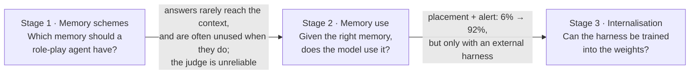

# Character Memory for Role-Play LLMs: from memory schemes to memory use to training

**An ongoing research line on why role-play characters forget, misremember and invent shared pasts, and what fixes it.
All experiments run on local open-weight models (vLLM on the SURF Snellius cluster).**

[中文说明](README_zh.md) · Stage 1: [`stage1_memory_schemes/`](stage1_memory_schemes/) · Stages 2–3: [`lifelikebench/`](lifelikebench/)



## The research question, in three steps

| | Stage 1: memory schemes | Stage 2: memory use (LifelikeBench) | Stage 3: internalisation |
|---|---|---|---|
| Question | Which memory scheme keeps a character consistent? | When the right memory is in context, does the model use it? Can it tell a real shared past from an invented one? | Can the harness's behaviour be distilled into the model? |
| Data | 47 real PIPPA role-play dialogues, scripted user turns | 13 bilingual characters with explicit timelines; scripted multi-turn probes | 40 training characters (disjoint from evaluation), 1,080 teacher dialogues |
| Models | Qwen2.5-7B, Llama-3.1-8B; judge Qwen2.5-14B | Qwen3-8B, Llama-3.1-8B, Qwen3-32B; judges Qwen3-32B + Gemma-3-27B | Qwen3-8B student with LoRA |
| Status | done | done | SFT and on-policy distillation trained; DPO and held-out evaluation queued |

## Stage 1: comparing memory schemes ([details](stage1_memory_schemes/))

Six conditions were run on identical user turns: no memory, raw recent context, vector top-k retrieval, structured character facts, shuffled facts (control) and a hybrid.
71 memory probes have verbatim gold answers.

- **The bottleneck is upstream.** The probe's answer reached the injected context in 62–68% of vector-retrieval runs
  but only 18–27% for structured memory (39–45% for the hybrid). Structured memory scored 26–28 pts below vector retrieval
  on probe accuracy (Holm-corrected, both models).
- **Memory that does arrive is often not used.** Even when the answer *was* in context, models answered correctly in only about
  30–65% of cases, depending on scheme and model.
- **The judge could not be trusted.** A blind audit found about 40% precision for the out-of-character judge, so those flags are
  reported only as noisy relative signals. Four silent pipeline failures were found and fixed, each with a regression test.

These findings set up stage 2. Because memory that arrives is often unused, the study turns from retrieval to *use* of memory. Because the judge is unreliable, the
evaluation itself has to be validated.

## Stage 2: does the model use the memory it has? ([LifelikeBench](lifelikebench/))

The focus is one failure. A user mentions a shared past that **contradicts** the story (*"Remember our trip five years ago?"*, though the two
met last month). The character should notice, while still accepting claims that **fit** the story, because role-play is co-created.

| Qwen3-8B, same memory content | Conflict noticed |
|---|---|
| card only | 6% |
| memory in the system prompt (harness) | 27% |
| memory next to the latest user turn | 42% |
| … plus a turn-local conflict alert | **92%** |

- Changing only *where* and *how* memory is presented moves detection from 27% to 92%, with paired tests significant at each step.
  Llama-3.1-8B and Qwen3-32B reach 88–92% with the alert.
- **No over-suspicion.** Compatible claims are accepted 95–99% of the time in every system.
- **Validated measurement**, a direct answer to stage 1. Two judges from different families agree on the main metric at α = 0.82,
  and an independent blind annotation pass agrees with them at α = 0.72–0.76. Unreliable dimensions are reported as such. A human round is in progress.
- **Harness.** Ornstein–Uhlenbeck affect state, plus memory tagged by provenance (stated / inferred / user canon / claimed)
  and flagged for conflict. This replaces stage 1's flat fact list, which overlapped with the card.

Results: [`lifelikebench/runs/claims_v1/claims_analysis.md`](lifelikebench/runs/claims_v1/claims_analysis.md).

## Stage 3: distilling the harness into the model ([training](lifelikebench/docs/TRAINING.md))

The teacher is Qwen3-8B with the harness. The student is the same model with LoRA and **no harness**. Three ways of transferring the behaviour are compared:

| Method | Signal | Status |
|---|---|---|
| SFT (context distillation) | imitate the teacher's filtered replies | trained (val loss 0.66 → 0.38) |
| DPO | teacher reply ≻ base reply for the same prompt | queued |
| On-policy distillation | the student samples; the same model with the adapter off, given the harness prompt, scores every token (reverse KL) | trained (val KL ≈ 0.145 → 0.060) |

The main metric is the share of the teacher–base gap that the student closes on held-out characters. The guardrails are compatible-claim acceptance and
naturalness. Run log: [`lifelikebench/runs/train_v1/SUMMARY.md`](lifelikebench/runs/train_v1/SUMMARY.md).

## What carried over from stage 1 to stage 2

| Stage 1 lesson | Stage 2 design |
|---|---|
| A single in-family judge with about 40% precision | Two judges from different families with structured output; blind annotation; per-dimension reliability reported |
| Memory reached the context but was unused | Probes that test the *use* of correct memory; placement and alert ablations |
| The fact list duplicated the character card | Memory tagged with provenance; user-added canon is separated from claims |
| PIPPA text cannot be redistributed | Original bilingual characters, so transcripts can be released ([`runs/`](lifelikebench/runs/)) |
| Silent failures produced plausible numbers | Phase-based, resumable runs; GPU-free tests; smoke jobs |

## Repository layout

```
stage1_memory_schemes/   memory-scheme comparison on PIPPA (scripts, docs, summary results; no dialogue text)
lifelikebench/           benchmark, harness, distillation (installable package)
  runs/                  released results: claims_v1, local_v0 (transcripts + judgments), train_v1 summary
  annotation/            blind annotation round 1, guidelines, agreement analysis
```

Each stage has its own README, tests and SLURM scripts (`python run_tests.py` in stage 1; `python -m pytest tests/` in `lifelikebench/`).

## Status and next steps

- [ ] Held-out evaluation of the SFT / DPO / OPD students (queued on the cluster)
- [ ] Human annotation round, and a two-axis rubric for mixed replies (final stance + whether a detail was invented)
- [ ] Persona minimal pairs; harder compatible claims; pairwise affect judgments
- [ ] GRPO with a judge-derived reward; a pure self-distillation ablation (8B as its own extractor)

## Author and citation

Xiaoyan Yang, PhD candidate in Computational Linguistics, University of Groningen (ERC project GOLEM). Code: MIT.
The character representation follows the GOLEM ontology: Pianzola, F., Cheng, L., Pannach, F., Yang, X., & Scotti, L. (2025).
The GOLEM Ontology for Narrative and Fiction. *Humanities*, 14(10), 193. https://doi.org/10.3390/h14100193
